# Kind Cluster with Cilium CNI & Cloud-Native DevOps Stack

This project provisions an enterprise-grade local Kubernetes cluster using `kind`, managed with modular **Terraform**, networked via **Cilium eBPF CNI**, secured by **HashiCorp Vault**, synchronized via **ArgoCD GitOps**, and routed via **Istio Ingress Gateway** with **TLS/SSL certificate termination**.

## 🎬 Animated DevOps Architecture & Lifecycle Diagram



---

## Prerequisites
- [Docker Desktop](https://www.docker.com/products/docker-desktop/) (must be running!)
- [Terraform](https://developer.hashicorp.com/terraform/downloads)

## Usage

1. **Start Docker Desktop** if it isn't running already.
2. Initialize Terraform:
   ```bash
   terraform init
   ```
3. Apply the configuration:
   ```bash
   terraform apply
   ```
   *(Wait for the cluster to start and Cilium to deploy. This might take a few minutes as images are pulled.)*

## Accessing the Cluster

Terraform writes the cluster's kubeconfig to a local file (e.g., `./kind-cilium-config`) instead of modifying your `~/.kube/config`.

To use `kubectl` with this cluster in PowerShell, run the hint provided in the Terraform output:
```powershell
$env:KUBECONFIG="$PWD\kind-cilium-config"
```
*(On bash/zsh, use `export KUBECONFIG="$PWD/kind-cilium-config"`)*

### Verifying the setup
```bash
# Check that all 3 nodes are Ready (this means Cilium is working)
kubectl get nodes

# Check that the Cilium DaemonSet is ready
kubectl -n kube-system get ds cilium

# Check that Hubble Relay and UI are running
kubectl -n kube-system get deploy hubble-relay hubble-ui
```

### Platform Endpoints
| Service | Host URL | Description |
|---|---|---|
| **Customer Web App** | [https://localhost:31000/](https://localhost:31000/) | Main grocery storefront (TLS 443) |
| **Admin Portal** | [https://localhost:31000/admin](https://localhost:31000/admin) | Administration dashboard (TLS 443) |
| **Vendor Portal** | [https://localhost:31000/vendor](https://localhost:31000/vendor) | Vendor catalog portal (TLS 443) |
| **Delivery Portal** | [https://localhost:31000/delivery-partner](https://localhost:31000/delivery-partner) | Delivery driver portal (TLS 443) |
| **Backend API Gateway** | [https://localhost:31000/api/products](https://localhost:31000/api/products) | Reverse-proxy gateway (TLS 443) |
| **Kiali Console** | [http://localhost:31001/](http://localhost:31001/) | Istio service mesh console |
| **Jaeger Tracing** | [http://localhost:31002/](http://localhost:31002/) | Distributed trace waterfalls |
| **Prometheus** | [http://localhost:31003/](http://localhost:31003/) | Metrics and alerts |
| **Grafana** | [http://localhost:31004/](http://localhost:31004/) | Dashboards (`admin` / `admin`) |
| **Hubble UI** | [http://localhost:31005/](http://localhost:31005/) | eBPF kernel network flow visualizer |
| **ArgoCD** | [http://localhost:31006/](http://localhost:31006/) | GitOps management (`admin` / `admin`) |
| **HashiCorp Vault** | [http://localhost:31007/](http://localhost:31007/) | Secrets engine UI (token: `root`) |

### Secret Management (Vault + External Secrets Operator)
- Secrets are stored in HashiCorp Vault under the `secret/` KV-v2 engine:
  - `secret/grocery/database` (MongoDB credentials)
  - `secret/grocery/backend` (JWT secret, Mongo connection strings)
- The **External Secrets Operator** reconciles `ExternalSecret` manifests and syncs values directly into native Kubernetes `Secret` resources (`mongodb-secret`, `backend-secret`).
- To view or update secrets via PowerShell:
  ```powershell
  # Read backend secrets
  .\scripts\vault-secrets.ps1 -Action Get -Path "grocery/backend"

  # Update database password
  .\scripts\vault-secrets.ps1 -Action Set -Path "grocery/database" -Data @{
      "MONGO_INITDB_ROOT_USERNAME" = "admin"
      "MONGO_INITDB_ROOT_PASSWORD" = "new-secure-password"
  }
  ```

## Cleanup
To destroy the cluster and all associated resources:
```bash
terraform destroy
```

