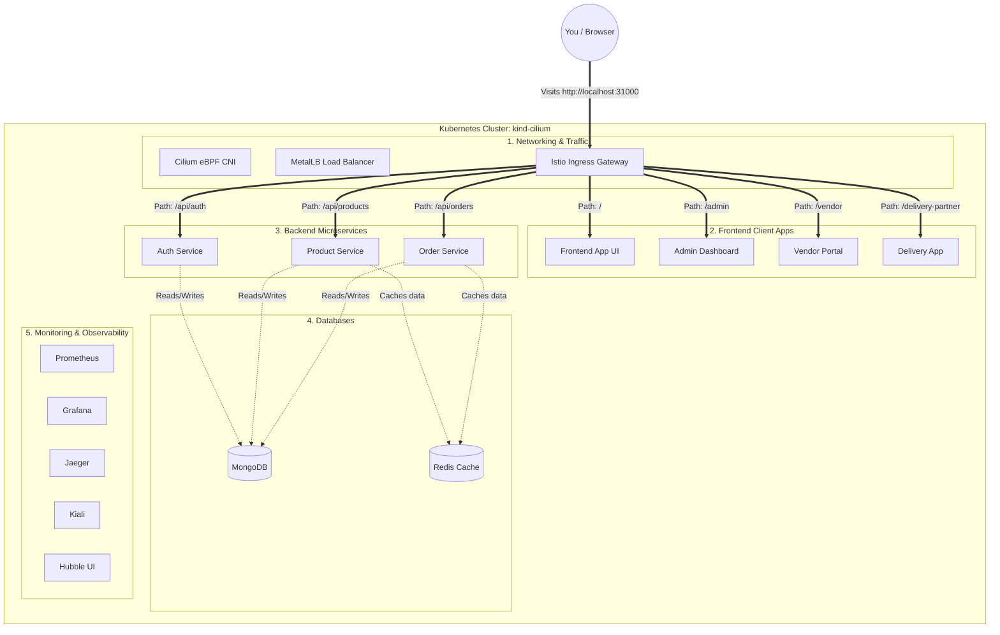

# GroceryHub Architecture

This document outlines the end-to-end architecture of the GroceryHub application running on a local Kubernetes (Kind) cluster.

## Architecture Flowchart

## How It Works (In Plain English)

1. **You (The User):** When you type `http://localhost:31000` in your browser, the request is sent to your local Kubernetes cluster.
2. **The Front Door (Istio):** The request hits the **Istio Ingress Gateway**. Think of Istio as a traffic cop. It looks at the URL path you typed in.
3. **Routing to the Frontends:** If you just go to `/`, Istio sends you to the **Frontend App**. If you go to `/admin`, it sends you to the **Admin Dashboard**, and so on.
4. **Routing to the Backends:** When the frontend apps need data (like a list of groceries or to log you in), they send a request to `/api/...`. Istio sees the `/api/` path and routes it directly to the correct **Backend Microservice** (Auth, Product, or Order).
5. **Saving Data:** The backend microservices talk to **MongoDB** to permanently save data, and use **Redis** to temporarily cache data so the app loads faster.
6. **Under the Hood:** **Cilium** handles all the invisible networking between the pods, and tools like **Grafana** and **Prometheus** watch the cluster to make sure everything is healthy.
