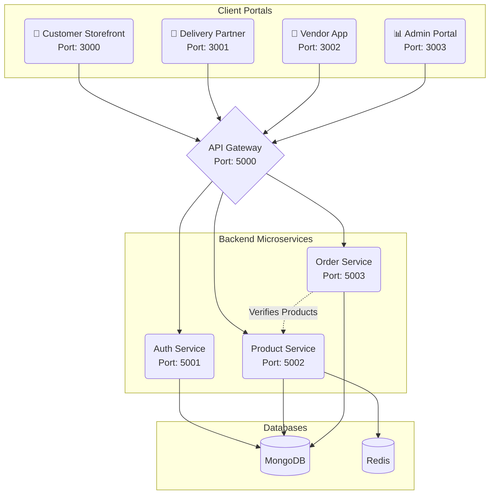
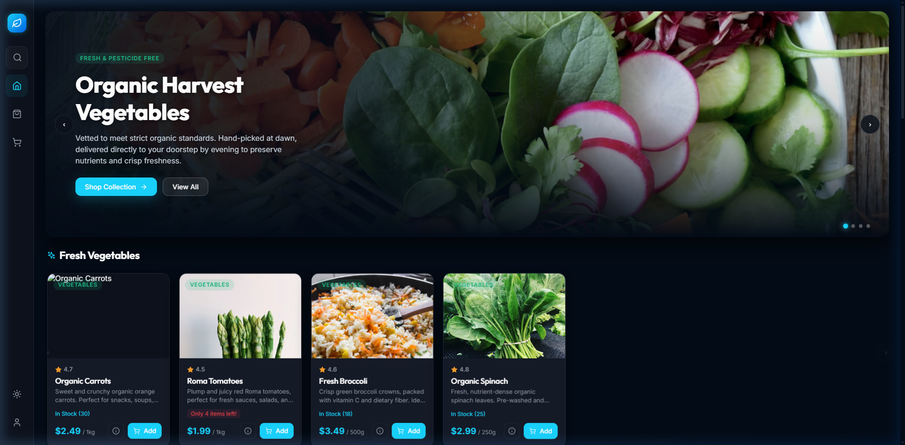
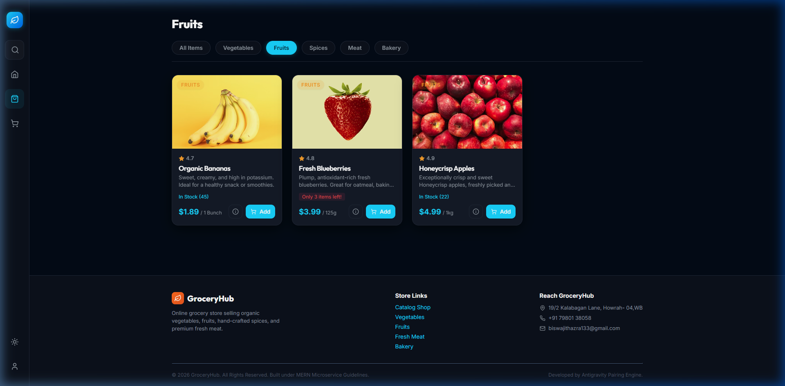
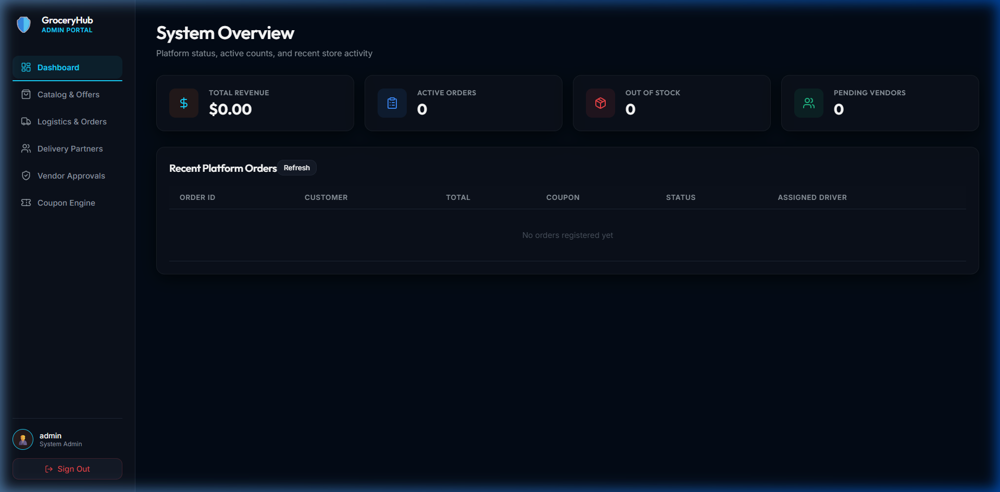
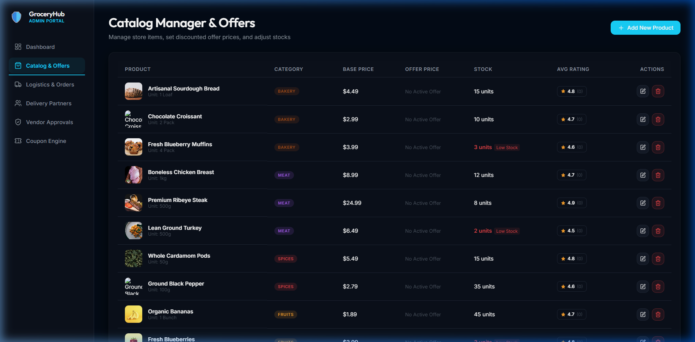
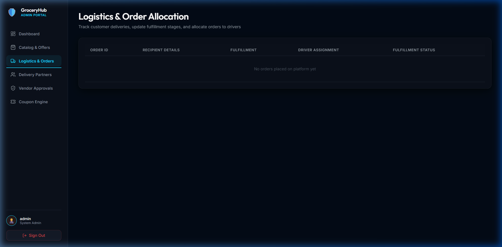
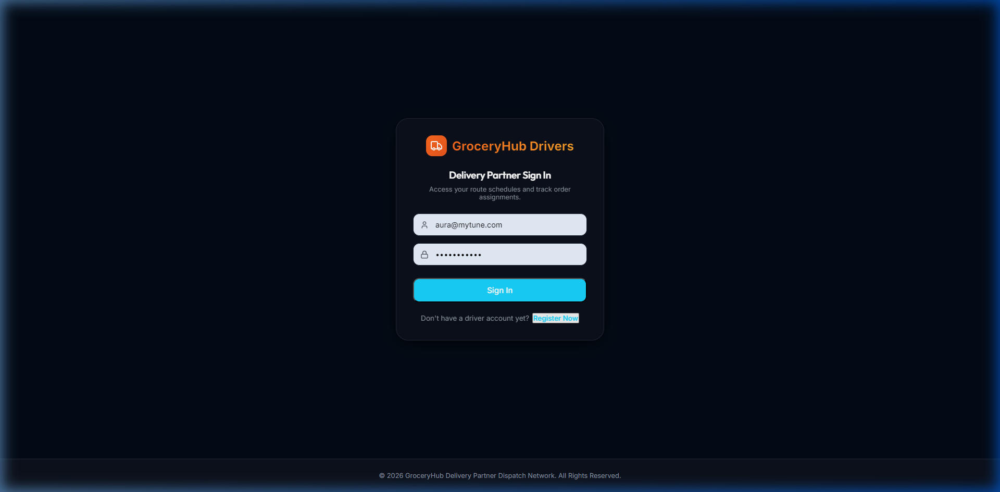

# 🍊 GroceryHub

Welcome to **GroceryHub**, a premium, modern, multi-user Grocery Platform featuring a synchronized logistics and order fulfillment lifecycle across all user portals. Built with **React** for client SPAs, styled using custom **Vanilla CSS** with a harmonious black-and-orange theme, and backed by a **Node.js/Express** microservices architecture orchestrated via **Docker Compose**.

---

## 🏗 Architecture



---

## 🎬 Platform Walkthrough & Live Transitions

Here is the live animation showing page loading, category navigation transitions, and the logged-in admin dashboard:


---

## 📸 Portal Screenshots

### 🛒 Customer Storefront (Port 3000)
Browse the catalog, filter categories, view discount pricing, and manage your cart.

#### Storefront Landing Page


#### Category Navigation (e.g. Fruits Catalog)


---

### 📊 Admin Portal (Port 3003)
The dashboard displays overall metrics, catalog listings, logistics tasks, vendor reviews, and active coupons.

#### Admin Dashboard


#### Catalog Manager


#### Logistics & Orders Tracker


---

### 🚚 Delivery Partner App (Port 3001)
Used by logistics drivers to accept orders and trace route transitions.

#### Portal Login


---


### Port Mapping & Purpose

| Port | Service Name | Tech Stack | Description |
| :--- | :--- | :--- | :--- |
| **27017** | `mongodb` | MongoDB 6.0 | Persistent data storage shared across services. |
| **6379** | `redis` | Redis Alpine | Fast caching layer for catalog requests. |
| **5001** | `auth-service` | Node / Express / Mongoose | Manages user registration, JWT logins, and approvals. |
| **5002** | `product-service`| Node / Express / Redis | Handles catalog query caching and vendor inventories. |
| **5003** | `order-service` | Node / Express / Axios | Validates stock levels, handles checkout, and evaluates coupons. |
| **3000** | `frontend` | React / Vite / Nginx | Portal for customers to browse, cart, and buy items. |
| **3001** | `delivery-partner`| React / Vite / Nginx | Portal for drivers to accept orders and track delivery routes. |
| **3002** | `vendor` | React / Vite / Nginx | Portal for vendors to approve inventory requests. |
| **3003** | `admin` | React / Vite / Nginx | Control panel to manage catalog, vendors, coupons, and orders. |

---

## 🚀 DevOps Infrastructure & GitOps Lifecycle

The GroceryHub platform is powered by an enterprise-grade cloud-native DevOps stack orchestrated locally via **Terraform** on a multi-port **Kind Kubernetes** cluster, secured with **HashiCorp Vault**, managed declaratively via **ArgoCD GitOps**, networked at the Linux kernel level with **Cilium eBPF**, routed through **Istio Service Mesh** with TLS termination, and monitored in real-time with an **Observability Suite**.

### 🎬 Animated DevOps Lifecycle Architecture


---

### ☸️ End-to-End DevOps Architecture Flowchart

```mermaid
%%{init: {'theme': 'dark', 'themeVariables': { 'darkMode': true, 'background': '#0a0d14', 'primaryColor': '#141c2b', 'primaryTextColor': '#f8fafc', 'primaryBorderColor': '#3b82f6', 'lineColor': '#38bdf8' }}}%%
flowchart TB
    %% =========================================================================
    %% STAGE 1: INFRASTRUCTURE AS CODE
    %% =========================================================================
    subgraph S1 ["🛠️ STAGE 1: Infrastructure as Code (Terraform)"]
        TF["Terraform Core v1.14<br><i>(10 Modular Providers)</i>"]
        Kind["Kind Cluster: kind-cilium<br><i>(K8s v1.36.4 on Docker)</i>"]
        Ports["Host Port Mapping<br><i>31000..31007</i>"]
        TF ==>|Provisions Engine| Kind
        Kind --- Ports
    end

    %% =========================================================================
    %% STAGE 2: ZERO-TRUST SECRECY & TLS PKI
    %% =========================================================================
    subgraph S2 ["🔐 STAGE 2: Zero-Trust Secrets & TLS PKI"]
        Vault[("HashiCorp Vault<br><i>KV-v2: secret/grocery/*</i>")]
        ESO["External Secrets Operator<br><i>ClusterSecretStore</i>"]
        TLS["Automated TLS PKI<br><i>Root CA + Leaf Cert</i>"]
        K8sSec["Native K8s Secrets<br><i>mongodb-secret, backend-secret, grocery-tls-cert</i>"]
        
        Vault ==>|Pulls Secrets| ESO
        ESO ==>|Syncs| K8sSec
        TLS ==>|Issues Certs| K8sSec
    end

    %% =========================================================================
    %% STAGE 3: GITOPS CONTINUOUS DELIVERY
    %% =========================================================================
    subgraph S3 ["🐙 STAGE 3: GitOps Continuous Delivery (ArgoCD)"]
        Argo["ArgoCD Controller<br><i>Auto-Heal & Drift Detection</i>"]
        W1["Wave 1: Database<br><i>grocery-database (Mongo & Redis)</i>"]
        W2["Wave 2: Backend<br><i>grocery-backend (Microservices)</i>"]
        W3["Wave 3: Clients<br><i>grocery-client (4x React SPAs)</i>"]
        
        Argo ==>|Sync Wave 1| W1
        W1 -.->|On Healthy| W2
        W2 -.->|On Healthy| W3
    end

    %% =========================================================================
    %% STAGE 4: KERNEL CNI & INGRESS EDGE
    %% =========================================================================
    subgraph S4 ["🐝 STAGE 4: Kernel CNI & Ingress Edge (Cilium & Istio)"]
        Cilium["Cilium eBPF CNI<br><i>Replaces kube-proxy</i>"]
        IstioGW["Istio Ingress Gateway<br><i>Port 443 (HTTPS) / NodePort 30000</i>"]
        VS["Istio VirtualService<br><i>Prefix Routing L7</i>"]
        Mesh["Istio Service Mesh<br><i>PeerAuthentication mTLS</i>"]
        
        IstioGW ==>|Routes Traffic| VS
        VS --- Mesh
        Cilium -.-|eBPF Packet Acceleration| Mesh
    end

    %% =========================================================================
    %% STAGE 5: RUNTIME WORKLOADS
    %% =========================================================================
    subgraph S5 ["📦 STAGE 5: Multi-Tier Runtime Workloads"]
        subgraph Frontends ["Client Portals (grocery-clint)"]
            F_Store["🛒 Storefront (/)"]
            F_Admin["📊 Admin (/admin)"]
            F_Vendor["🏪 Vendor (/vendor)"]
            F_Driver["🚚 Delivery (/delivery-partner)"]
        end

        subgraph BackendTier ["Microservices (grocery-backend)"]
            API_GW["⚡ API Gateway (5000)"]
            S_Auth["🔑 Auth Service (5001)"]
            S_Prod["📦 Product Service (5002)"]
            S_Order["🛒 Order Service (5003)"]
        end

        subgraph DataTier ["Data Tier (grocery-database)"]
            DB_Mongo[("🍃 MongoDB StatefulSet")]
            DB_Redis[("⚡ Redis Cache")]
        end

        VS ==>|Path: /| F_Store
        VS ==>|Path: /admin| F_Admin
        VS ==>|Path: /vendor| F_Vendor
        VS ==>|Path: /delivery-partner| F_Driver
        VS ==>|Path: /api/*| API_GW

        API_GW --> S_Auth
        API_GW --> S_Prod
        API_GW --> S_Order
        S_Order -.-> S_Prod

        S_Auth --> DB_Mongo
        S_Prod --> DB_Mongo
        S_Prod --> DB_Redis
        S_Order --> DB_Mongo
        S_Order --> DB_Redis
    end

    %% =========================================================================
    %% STAGE 6: 360° OBSERVABILITY
    %% =========================================================================
    subgraph S6 ["📊 STAGE 6: 360° Observability & Telemetry"]
        Prom["🔥 Prometheus (31003)<br><i>Metrics & Scrapes</i>"]
        Graf["📊 Grafana (31004)<br><i>Dashboards</i>"]
        Jaeg["🔍 Jaeger (31002)<br><i>Distributed Tracing</i>"]
        Kiali["🕸️ Kiali (31001)<br><i>Mesh Visualizer</i>"]
        Hubble["🌐 Hubble UI (31005)<br><i>eBPF Network Flows</i>"]
        Loki["📋 Loki Stack<br><i>Log Aggregation</i>"]

        Prom --> Graf
        Loki --> Graf
    end

    %% External User Access
    User(("👤 Client Browser")) ===>|HTTPS: localhost:31000| IstioGW

    %% Secret Injection
    K8sSec -.->|Injects DB Envs| DataTier
    K8sSec -.->|Injects JWT & DB URIs| BackendTier
    K8sSec -.->|Mounts TLS Cert| IstioGW

    %% Observability Taps
    S5 -.->|Metrics| Prom
    S5 -.->|Traces| Jaeg
    S5 -.->|Logs| Loki
    Mesh -.->|Topology| Kiali
    Cilium -.->|eBPF Flows| Hubble

    %% Styling & Flowing animations
    classDef stage fill:#0f172a,stroke:#334155,stroke-width:1.5px,color:#f8fafc;
    classDef active fill:#1e293b,stroke:#06b6d4,stroke-width:2px,color:#f8fafc;
    classDef secret fill:#2e1f18,stroke:#f59e0b,stroke-width:1.5px,color:#fde68a;
    classDef gitops fill:#1a1d2e,stroke:#ff6b00,stroke-width:1.5px,color:#fed7aa;
    classDef edge fill:#132338,stroke:#38bdf8,stroke-width:2px,color:#bae6fd;
    classDef db fill:#13231a,stroke:#10b981,stroke-width:1.5px,color:#a7f3d0;
    classDef obs fill:#1e1b4b,stroke:#a855f7,stroke-width:1.5px,color:#ddd6fe;

    class S1,S2,S3,S4,S5,S6 stage;
    class Vault,ESO,TLS,K8sSec secret;
    class Argo,W1,W2,W3 gitops;
    class IstioGW,VS,Mesh edge;
    class DB_Mongo,DB_Redis db;
    class Prom,Graf,Jaeg,Kiali,Hubble,Loki obs;

    linkStyle 0 stroke:#3b82f6,stroke-width:2px;
    linkStyle 1 stroke:#f59e0b,stroke-width:2px,stroke-dasharray: 4 4;
    linkStyle 2 stroke:#10b981,stroke-width:2px,stroke-dasharray: 4 4;
    linkStyle 3 stroke:#10b981,stroke-width:2px,stroke-dasharray: 4 4;
    linkStyle 4 stroke:#ff6b00,stroke-width:2px;
    linkStyle 7 stroke:#06b6d4,stroke-width:2px;
    linkStyle 25 stroke:#ff6b00,stroke-width:3px;
```



---

### 🌐 Platform Endpoints & Ingress Matrix

| Service | Protocol / Port | Direct URL | Description & Credentials |
| :--- | :---: | :--- | :--- |
| **Customer Storefront** | `HTTPS : 31000` | [https://localhost:31000/](https://localhost:31000/) | Customer marketplace SPA (TLS Root CA terminated) |
| **Admin Portal** | `HTTPS : 31000` | [https://localhost:31000/admin](https://localhost:31000/admin) | Central administrative panel & catalog management |
| **Vendor Portal** | `HTTPS : 31000` | [https://localhost:31000/vendor](https://localhost:31000/vendor) | Vendor stock review & inventory portal |
| **Delivery Portal** | `HTTPS : 31000` | [https://localhost:31000/delivery-partner](https://localhost:31000/delivery-partner) | Real-time driver fulfillment & tracking portal |
| **Backend API Gateway** | `HTTPS : 31000` | [https://localhost:31000/api/products](https://localhost:31000/api/products) | Reverse-proxy gateway routing to backend microservices |
| **Kiali Service Mesh** | `HTTP : 31001` | [http://localhost:31001/](http://localhost:31001/) | Istio live topology graph, mTLS health & traffic animation |
| **Jaeger Tracing** | `HTTP : 31002` | [http://localhost:31002/](http://localhost:31002/) | End-to-end distributed transaction tracing |
| **Prometheus** | `HTTP : 31003` | [http://localhost:31003/](http://localhost:31003/) | Cluster-wide metric collection & alert evaluation |
| **Grafana Dashboards** | `HTTP : 31004` | [http://localhost:31004/](http://localhost:31004/) | Pre-configured metrics visualizations (`admin` / `admin`) |
| **Hubble UI** | `HTTP : 31005` | [http://localhost:31005/](http://localhost:31005/) | Cilium eBPF kernel network flow & security visualizer |
| **ArgoCD UI** | `HTTP : 31006` | [http://localhost:31006/](http://localhost:31006/) | GitOps deployment controller (`admin` / `admin`) |
| **HashiCorp Vault** | `HTTP : 31007` | [http://localhost:31007/](http://localhost:31007/) | Enterprise secret management KV-v2 UI (Token: `root`) |

---

### 🛡️ DevOps Stage Breakdown

#### Stage 1: Infrastructure as Code (Terraform & Kind)
- **Modular Terraform:** Orchestrated into modular Terraform definitions ([DevOps/modules](file:///o:/Grocery-app/DevOps/modules)) managing cluster creation, CNI, secret managers, service mesh, and GitOps deployments.
- **Port Forwarding:** The Kind cluster maps container NodePorts `30000..30007` to predictable host ports `31000..31007` directly through Docker.

#### Stage 2: Zero-Trust Secrets Management & TLS PKI
- **HashiCorp Vault:** Securely holds database credentials (`MONGO_INITDB_ROOT_PASSWORD`) and backend signing keys (`JWT_SECRET`).
- **External Secrets Operator (ESO):** Reconciles `ExternalSecret` manifests against a `ClusterSecretStore`, keeping native Kubernetes secrets continually in sync without committing raw secrets to git.
- **Automated TLS PKI:** A dedicated 10-year **GroceryHub Local Root CA** and an RSA 2048-bit leaf certificate for `localhost` and `127.0.0.1` are generated by Terraform and stored in `grocery-tls-cert`.

#### Stage 3: Declarative GitOps Delivery (ArgoCD)
- **ArgoCD Sync Waves:** Applications are deployed in topological order:
  - **Wave 1:** `grocery-database` (MongoDB & Redis StatefulSets).
  - **Wave 2:** `grocery-backend` (Auth, Product, Order, and API Gateway microservices).
  - **Wave 3:** `grocery-client` (Storefront, Admin, Vendor, and Delivery SPAs).
- **Self-Healing:** Automatic drift correction and resource pruning ensure cluster state matches the git repository.

#### Stage 4: Kernel CNI & Ingress Edge (Cilium & Istio)
- **Cilium eBPF:** Displaces `kube-proxy` to route network packets directly in Linux kernel space, offering sub-millisecond pod-to-pod latency and L3/L4/L7 policy filtering.
- **Istio Ingress Gateway:** Serves as the unified HTTPS ingress entry point on NodePort `30000` (host port `31000`), terminating TLS 1.3 traffic and enforcing mutual TLS (`mTLS`) between internal pods.

#### Stage 5: Microservices & Data Runtime
- **Microservices:** Stateless Node.js/Express services executed under non-root users (`node`).
- **Data Persistence:** MongoDB with persistent volumes and Redis for high-speed catalog querying and caching.

#### Stage 6: 360° Observability & Telemetry
- **Prometheus & Grafana:** Comprehensive monitoring of CPU, memory, HTTP request rates, and Istio Envoy metrics.
- **Jaeger & Kiali:** Distributed request trace waterfalls and live visual graph representation of inter-pod traffic.
- **Hubble UI:** eBPF-level observability inspecting TCP handshakes, DNS resolutions, and dropped packets in real time.


### Run Local Development (Build from Source)
To run and build all services dynamically from your local codebase directory:
```bash
docker compose -f src/docker-compose.dev.yml up -d --build
```

### Run Production (Serve Built Registry Images)
To fetch and run pre-built registry images:
```bash
docker compose -f src/docker-compose.yaml up -d
```

### Hardened Docker Security (DevOps Ready)
- **Non-Root Isolation:** The Node backend microservices execute under the `node` user, and the frontend portals execute Nginx under the non-privileged `nginx` user to mitigate runtime exploits.
- **Image Size Minimization:** Double-stage builds are implemented for the frontend to prevent bundle tools from leaking to production.
- **Context Boundaries:** Dedicated `.dockerignore` files are located in all service roots to prevent leaking local development secrets (`.env`) or heavy folders (`node_modules`) into production images.
- **Microservice Healthchecks:** Docker Engine monitors liveness probes using Alpine-native `wget` triggers pointing to individual service `/health` endpoints.

---

## 🛠️ Microservice Life Cycle Synchronization

A background polling hook running on all frontends triggers active order details fetch operations every `3 seconds`. This permits status updates (Placed $\rightarrow$ Validated $\rightarrow$ Prepared $\rightarrow$ Transit $\rightarrow$ Delivered) to sync seamlessly across customer, vendor, admin, and driver portals without requiring full page refreshes.
